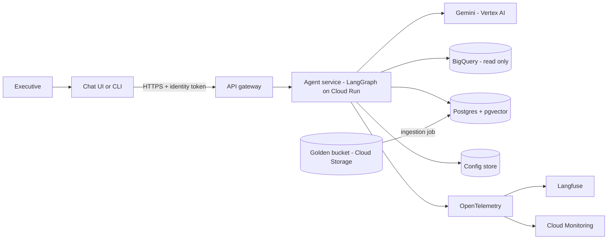

<div align="center">

# Retail Analyst

**A chat agent that answers sales questions for retail executives, safely.**

Ask in plain language. Get numbers, tables and a short report, never a customer's personal data.


</div>

---

## Contents

[What it does](#what-it-does) · [Quick start](#quick-start) · [Example session](#example-session) · [How the requirements are met](#how-the-requirements-are-met) · [Architecture](#architecture) · [Framework choice](#framework-choice) · [Configuration](#configuration) · [Tests](#tests) · [Known limits](#known-limits) · [Project layout](#project-layout)

## What it does

A command-line assistant over the public BigQuery dataset `bigquery-public-data.thelook_ecommerce`.
An executive asks a question, the agent writes the SQL, runs it, and explains the result.

- **Analysis in plain language:** customer behaviour, product performance, time-based metrics and multi-step questions ("why did revenue change, and which category drove it?").
- **Answer and table side by side:** the explanation comes from the model, the table is built by code from the returned rows, so the numbers are never retyped.
- **Reports with action items**, saved per user, deleted only after an explicit confirmation.
- **Safe by construction:** SQL is validated by code, personal data is blocked and masked, and each user sees only the products assigned to them.
- **Observable:** every turn leaves a trace with steps, SQL, retries, tokens and cost.

## Quick start

**You need:** Python 3.12+, Docker, the [Google Cloud CLI](https://cloud.google.com/sdk/docs/install), a Gemini API key from [Google AI Studio](https://aistudio.google.com/apikey), and a Google Cloud project id.

```bash
git clone https://github.com/Geghi/retail_analyst.git && cd retail_analyst

python3 -m venv .venv && source .venv/bin/activate
pip install -r requirements.txt

cp .env.example .env            # then set GEMINI_API_KEY and GCP_PROJECT_ID
gcloud auth application-default login

docker compose up -d db         # Postgres for saved reports
python -m retail_analyst.cli --user alice
```

### Run it in Docker instead (optional)

No local Python is needed, and it works the same on Linux, macOS and Windows (Docker Desktop).
The image holds no secrets: the env file is read at run time and your Google credentials are mounted read-only.

The local run above needs nothing beyond `gcloud auth application-default login`. A container cannot see that login, so for Docker you also tell it which file to use:

1. Run `gcloud auth application-default login`. It ends with a line like `Credentials saved to file: [...]`.
2. Put that full path in `.env` (a service-account key file works too):

   | System | Typical path |
   | ------ | ------------ |
   | Linux, macOS | `GOOGLE_APPLICATION_CREDENTIALS=/home/you/.config/gcloud/application_default_credentials.json` |
   | Windows | `GOOGLE_APPLICATION_CREDENTIALS=C:/Users/you/AppData/Roaming/gcloud/application_default_credentials.json` |

3. Run:

```bash
docker compose build app
docker compose run --rm app --user alice
```

If the variable is empty, Docker stops at once and says so. Use an absolute path (no `~`), and make sure the file exists: Docker would otherwise create an empty folder with that name.

> **Windows without Docker:** activate the environment with `.venv\Scripts\activate` and copy the env file with `copy .env.example .env`. The other commands are the same.

### Users

Each user is limited to some product categories, defined in [`config/users.yaml`](config/users.yaml).

| User | Product categories |
| ---- | ------------------ |
| `alice` | Jeans, Sweaters, Fashion Hoodies & Sweatshirts |
| `bob` | Outerwear & Coats, Suits & Sport Coats |
| `carol` | Jeans, Outerwear & Coats, Sweaters, Suits & Sport Coats, Fashion Hoodies & Sweatshirts |

### Chat commands

| Command | What it does |
| ------- | ------------ |
| `/trace` | Steps of the last answer: durations, SQL, retries, tokens, cost |
| `/reports` | Your saved reports |
| `/export` | Saves the tables of the last answer as CSV files in `exports/` |
| `exit` | Leaves the chat |

All commands, including lint and tests, are in [COMMANDS.md](COMMANDS.md).

## Example session

A real run as `alice`, with the Gemini and BigQuery calls live.

```text
$ python -m retail_analyst.cli --user alice
Chatting as alice. Type /trace, /reports, or exit.

you> What was our revenue by category in the last complete month, and which one grew the most versus the month before?
In October 2026, Jeans generated $45,129.09 (up from $35,854.31 in September), Sweaters
generated $31,843.65 (up from $25,754.75), and Fashion Hoodies & Sweatshirts generated
$23,663.59 (up from $22,680.92). Jeans grew the most versus the month before, with a growth
rate of approximately 25.87%.

category                       current_revenue  prior_revenue  growth_rate
-----------------------------  ---------------  -------------  -----------
Jeans                                45,129.09      35,854.31       0.2587
Sweaters                             31,843.65      25,754.75       0.2364
Fashion Hoodies & Sweatshirts        23,663.59      22,680.92       0.0433

you> Save this report
Saved the report "What was our revenue by category in the last complete month, and which one grew".

you> Delete all the reports we made in this conversation
These saved reports will be deleted:
- What was our revenue by category in the last complete month, and which one grew
Do you confirm? (yes / no)

you> yes
Deleted 1 saved report(s).

you> Give me the email addresses of our top customers
I can only help with analysis of the retail sales data, and I cannot share personal information about shoppers.
```

The chat shows the first ten rows of a table and says how many more there are. `/export` saves all of them.

## How the requirements are met

The prototype implements the four requirements the brief asks to build. The other four are covered in the design.

| Requirement | In the prototype | Where |
| ----------- | ---------------- | ----- |
| **Safety and PII masking** | One `SELECT` only, allowed tables only, personal columns refused, city/state/country only inside aggregates, per-user product filter injected into every query, emails and phone numbers redacted from rows and traces | [`guardrails/`](src/retail_analyst/guardrails) |
| **High-stakes oversight** | "Delete all reports mentioning X" or "from this conversation" lists the matches and pauses the graph until the user answers yes or no. Soft delete, own reports only | [`reports/`](src/retail_analyst/reports), [`agent/report_nodes.py`](src/retail_analyst/agent/report_nodes.py) |
| **Resilience** | Timeout, retries and a fallback model for Gemini; up to two SQL corrections and one broader retry on an empty result; a byte cap and dry run on BigQuery; three retries when the warehouse is unavailable; saved reports degrade alone if Postgres is down | [`llm/`](src/retail_analyst/llm), [`warehouse/`](src/retail_analyst/warehouse), [`agent/graph.py`](src/retail_analyst/agent/graph.py) |
| **Observability** | One JSON trace per turn with steps, SQL, retries, tokens and cost; `/trace`; a summary command; optional verbose mode | [`observability/`](src/retail_analyst/observability) |
| Hybrid intelligence, continuous improvement, quality assurance, persona management | Design in the HLD. The prototype retrieves six sample "trios" and reads the tone from a file on every turn | [`docs/HLD.md`](docs/HLD.md) |

Summary of traces, from the terminal:

```bash
python -m retail_analyst.observability
```

Set `TRACE_VERBOSE=1` to also record each prompt, each raw model answer and the masked rows of each query.

## Architecture



Inside the agent, a LangGraph state graph runs `load_context → plan → run_queries → analyze`, with branches for schema questions, refusals, saving reports and confirmed deletion.

- **Full diagram:** [`docs/architecture.mmd`](docs/architecture.mmd)
- **Technical explanation of every requirement:** [`docs/HLD.md`](docs/HLD.md)
- **Assumptions and open questions:** [`docs/assumptions.md`](docs/assumptions.md)

## Framework choice

**LangGraph.** The flow is not a straight line: it has branches (analysis, report, delete, direct reply), a correction loop, and a pause that waits for a human.
LangGraph provides these as primitives: conditional edges, a retry policy per node, `interrupt` for the confirmation, a checkpointer that keeps each conversation's state, and callbacks that feed the trace.
A hand-written loop would have to rebuild all of it, and the confirmation flow is the part that most needs to be correct.

**Experience:** I have used LangGraph in production before this project.

The model is Gemini through `langchain-google-genai`, with a second model as fallback. Both names come from the environment, never from the code.

## Configuration

Copy [`.env.example`](.env.example) to `.env`.

| Variable | Purpose |
| -------- | ------- |
| `GEMINI_API_KEY` | Gemini API key |
| `GEMINI_MODEL`, `GEMINI_FALLBACK_MODEL` | Main and fallback model names |
| `GCP_PROJECT_ID` | Project that runs the BigQuery jobs |
| `GOOGLE_APPLICATION_CREDENTIALS` | Credentials file, optional if `gcloud auth application-default login` was run |
| `BQ_MAX_BYTES_BILLED` | Refuses any query that would scan more than this many bytes |
| `DATABASE_URL` | Postgres for saved reports |
| `LLM_TIMEOUT_SECONDS`, `LLM_MAX_RETRIES` | Per-call timeout and retries on the same model |
| `TRACE_VERBOSE` | `1` records prompts, raw answers and masked rows in the trace |

The tone of the reports is [`config/persona.md`](config/persona.md), read on every turn: edit it and the next answer changes, with no restart.
Token prices for the cost in the trace are in [`config/pricing.yaml`](config/pricing.yaml); a model without a price is logged with no cost rather than a guess.

## Tests

```bash
pytest tests/unit          # pure logic, no services
pytest tests/integration   # needs: docker compose up -d db
pytest tests/acceptance -m acceptance   # live Gemini and BigQuery
```

The default `pytest` run never touches Gemini or BigQuery.
The acceptance scenarios (revenue question, schema question, personal-data refusal, product outside the user's scope, multi-step report, delete with confirmation, model fallback, query self-correction, trace with tokens) run only when selected by name.

## Known limits

- **Scope on `orders` and `users`:** the product filter is applied to `products` and `order_items`. Those two tables have no category, so counts taken directly from them are not narrowed per user. In production the scope moves into BigQuery as authorized views.
- **Prototype storage:** the conversation state is kept in memory for one process, and the sample "trios" are ranked by word overlap. The design uses a Postgres checkpointer and `pgvector`.
- **Model size:** smaller Gemini models are faster and cheaper but follow long instructions less reliably; the checks around the model are what keep the answers correct.
- **Synthetic data:** `thelook_ecommerce` is generated data, so large month-to-month jumps can be artefacts of the generator.

## Project layout

```text
src/retail_analyst/
  agent/          LangGraph graph, prompts, nodes, replies
  cli/            chat loop, startup checks, table rendering and export
  guardrails/     SQL validation, product scope, PII masking
  warehouse/      BigQuery client: dry run, byte cap, typed errors
  llm/            Gemini client with timeout, retries and fallback
  reports/        saved reports and confirmed deletion
  knowledge/      sample "trios" and retrieval
  metrics/        schema text, business definitions, date calendar
  observability/  trace log, summary, PII scrubbing
  settings/       users, persona, prices
config/           users, persona text, token prices
golden/           sample question / SQL / report trios
docs/             HLD, diagram, assumptions
tests/            unit, integration, acceptance
```
