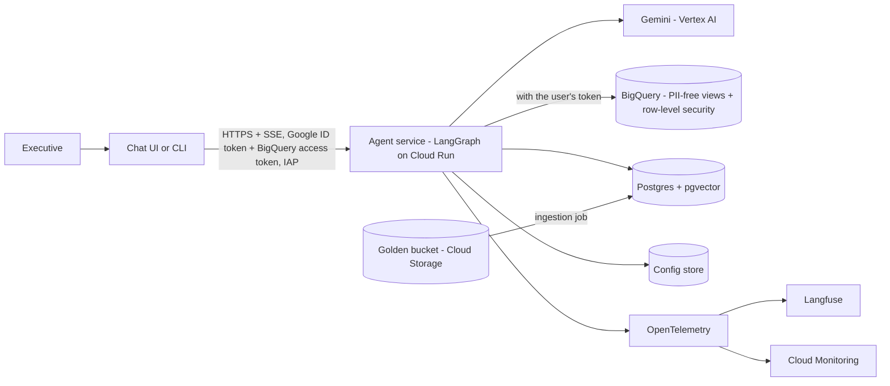

# High-level design

Design of the retail data-analysis assistant: the production target and what the prototype implements of it.
Diagram source: [architecture.mmd](architecture.mmd).
Decisions the brief leaves open: [assumptions.md](assumptions.md).

## 1. What we are building

Non-technical executives ask questions about sales and performance in plain language and discuss the answers.
The agent writes SQL on BigQuery, reads the results, explains them and, on request, produces a report with action items.
Four properties shape the whole design:

- It answers only analysis questions, and an executive sees only the products assigned to them.
- Personal data of shoppers never reaches the output.
- Deleting a saved report is the only destructive action, and it always needs an explicit confirmation.
- A failure of Gemini or BigQuery degrades the answer, never the interface.

## 2. Architecture

The detailed diagram, with the internals of the agent service and the learning loop, is in [architecture.mmd](architecture.mmd).

### How the components talk

| From → to | Protocol | Authentication |
| --------- | -------- | -------------- |
| UI → agent service | HTTPS and JSON to Cloud Run, server-sent events for streaming answers | Google sign-in: the executive's Google ID token and an OAuth access token with a BigQuery scope. IAP admits only the company Workspace domain. |
| Agent → Gemini | Vertex AI API over HTTPS | Agent service account, no key in the image |
| Agent → BigQuery | BigQuery API over HTTPS, a dry run before each query, job labels with the trace id and user id | The executive's own short-lived access token. The agent service account has no BigQuery data access. |
| Agent → Postgres | SQL over TLS on a private address through the Cloud SQL connector | IAM database authentication |
| Agent → config store | Read at every turn, cached for a few seconds | Agent service account |
| Ingestion job → bucket and Postgres | Cloud Storage API and SQL | Service account |
| Offline jobs → BigQuery | BigQuery API over HTTPS | Offline service account, read access to the PII-free views only |
| Agent → observability | OpenTelemetry (OTLP) to a collector, after the PII scrubber | Agent service account |

### Components and why

| Block | Choice | Why |
| ----- | ------ | --- |
| Front end | Web chat in production, CLI in the prototype | The agent core is a library with no UI code, so a new front end is a thin adapter. |
| Identity | Google sign-in in the web chat, Identity-Aware Proxy (IAP) in front of Cloud Run | IAP lets only the company Workspace domain reach the service. The agent service verifies the Google ID token itself with the `google-auth` library, so the user id comes from a verified token and is never taken from the model or the request body. The OAuth access token, with a BigQuery scope, runs each BigQuery job as the executive. The agent does not store refresh tokens. |
| Agent service | Python on Cloud Run, stateless | Scales to zero, scales out per request, and keeps conversation state in Postgres so any instance can serve any turn. |
| LLM | Gemini through Vertex AI in production, AI Studio key in the prototype | The brief asks for Gemini. Vertex AI adds IAM, quotas per project and regional control. A Flash-class model plans the queries and writes the answer, a Flash-Lite model is the fallback, and a Pro-class model is used for long reports only if the evaluation set shows a gain. Model names are configuration, never code. |
| Agent framework | LangGraph state graph | The flow has branches (analysis, report, delete, direct reply), a correction loop and a pause for human confirmation. LangGraph provides these as primitives: conditional edges, per-node retry policies, `interrupt` for the confirmation, a checkpointer that keeps each conversation's state by thread id, and callbacks for tracing. |
| Warehouse | BigQuery through a `BigQueryClient`, each job run with the executive's own token on PII-free views with row-level security | The data already lives there. The client runs a dry run before every query, refuses queries above the byte cap, labels each job with the trace id and user id, maps Google errors to typed errors and returns JSON-friendly rows. Executives can read the views and cannot write. |
| State | Cloud SQL Postgres with the `pgvector` extension | Saved reports, pending deletions, conversation checkpoints, preferences and the knowledge index in one engine. The expected knowledge base is hundreds to a few thousand trios, well within `pgvector`, and the permission filter on trios is a plain `WHERE` in the same query. |
| Golden bucket | Cloud Storage, versioned | The source of truth for the analysts' trios. Files are reviewable and recoverable. |
| Config store | Versioned documents in a bucket or database | Persona text, metric definitions and user scopes change without a deploy. |
| Secrets | Secret Manager | Keys never live in images or repositories. |
| Observability | OpenTelemetry to Langfuse and Cloud Monitoring | See section 5.7. |

## 3. Request flow

1. The agent service verifies the Google ID token with `google-auth` to get a trusted user id, and keeps the executive's short-lived BigQuery access token for this request only.
2. `load_context` loads the user's product scope, the persona text, a calendar of ready-made date ranges built in code from today's date, and the most similar approved trios for the question. The calendar is placed first in the prompt, and a named period ("this month", "January last year", "the same days last year") is copied from it, so the model never works out a date itself.
3. `plan` is the first Gemini call. It receives the question, the conversation so far, the schema description, the metric definitions and the trios, and replies with one JSON object holding an intent and, for an analysis, the SQL queries. The intents are analysis, schema question, greeting, save report, delete reports and other. Other (off-topic requests, requests for personal data, attempts to override instructions) ends in a polite refusal with no further model call.
4. `run_queries` checks every query deterministically: a single `SELECT`, allowed tables only, no personal columns, and a rewrite so only the user's products are visible. The `BigQueryClient` then runs a dry run to estimate cost, refuses an over-budget query and executes the rest. In production both run with the executive's token, so BigQuery applies the PII-free views and the row-level policies of the executive's group as well. Returned rows pass through result masking as a second line of defense.
5. A rejected or failing query goes back to `plan` together with the error, for at most two corrections. An empty result gives the model one hint to broaden the query. After the limit the user gets a friendly message.
6. `analyze` is the second Gemini call. It receives the masked rows as untrusted data and writes the answer or report, separating observed facts from hypotheses. It may ask for follow-up queries, which run through the same checks, for up to three query rounds in total. The prompt states how many rows of each result the model sees out of how many exist, and the model must say when a result was cut.
7. Schema questions and greetings are answered directly from the plan, with no query.
8. Save report stores the last answer in Postgres for the user and the conversation, titled with the user's question.
9. Delete reports lists the matching reports and creates a pending deletion. The graph then pauses at `confirm` until the user answers: yes performs the soft delete, no cancels.
10. The reply carries the answer text and, next to it, the result tables built by code from the masked rows, so the numbers an executive reads are never retyped by the model. The first rows are shown in the chat and an export saves every row as a CSV file.
11. Every node emits trace events tagged with one trace id per turn, and the conversation state is checkpointed by thread id.

## 4. Data and where it lives

| Data | Store | Notes |
| ---- | ----- | ----- |
| Raw transactions | BigQuery | Never copied out of BigQuery. The agent only reads aggregates, through the PII-free views. |
| Saved reports, pending deletions | Postgres | Owned by one user. Deletion is soft and recoverable for 30 days. |
| Conversation state | Postgres (LangGraph checkpointer) | Needed for "delete the reports from this conversation" and for follow-up questions. |
| User preferences | Postgres | Section 5.4. |
| Golden trios | Cloud Storage and Postgres | Files are the source of truth. Embeddings and metadata sit in Postgres for search. |
| Persona, metrics, scopes | Config store | Versioned, so a bad change can be rolled back. |
| Traces and logs | Langfuse and Cloud Monitoring | Prompts and results are stored with the same masking rules as the output. |

## 5. How each requirement is handled

### 5.1 Hybrid intelligence (Golden Knowledge)

A trio is a question, the SQL queries an analyst used and the analyst's report.
The agent uses trios to learn which metrics to look at, how to break a problem down and how to word conclusions, and it always writes fresh SQL for the new question.

- **At question time:** the question is embedded and the top three approved trios are retrieved from `pgvector`. They are placed in the prompt as guidance, with the instruction not to copy them.
- **Filtering:** trios are filtered by the user's permissions before they reach the prompt, because a report about a product the user cannot see would leak it.
- **Prototype:** six invented trios and a word-overlap ranking. Only the retrieval method differs from production.
- **Adding:** a new trio goes through validation (its SQL parses and runs, its numbers match its report, no personal data), then analyst approval, then it is written to the bucket, embedded and indexed.
- **Updating:** a changed trio becomes a new version and is re-indexed. The old version is kept for audit.
- **Retiring:** a trio is marked inactive and excluded from retrieval, for example when a metric definition changes. Age alone is not a reason, because old methods can stay valid.
- **Deleting:** content, embeddings and cached copies are removed when required, for example for a legal reason.
- **Why an approval step:** a successful query does not prove the analysis is right. Unverified model output must not become trusted knowledge.

### 5.2 Safety and PII masking

Security is enforced by code around the model, never by the prompt.

- **Input safety:** only analysis questions are answered. Other requests, attempts to reveal instructions and attempts to widen access are refused.
- **SQL guardrails:** one `SELECT` on the four tables only. Personal columns (names, emails, street address, postal code, coordinates) are refused wherever they appear. City, state and country are allowed only as grouping dimensions of aggregates.
- **Product scoping:** after the model writes the SQL, `products` and `order_items` are replaced by filtered subqueries that contain only the user's categories. The model cannot widen this, whatever it writes.
- **Prototype limit:** the code rewrite does not product-scope `orders` and `users`, so an order count across all products could be inferred. In production row-level access policies on `orders`, `users` and `order_items` scope them too.
- **Result masking:** values that look like emails or phone numbers are redacted from returned rows, as a second line of defense.
- **Identity:** the agent service verifies the Google ID token itself with `google-auth`. The user id comes from that verified token and is passed to every tool by the service, never by the model. In production every BigQuery job runs with the executive's own short-lived access token, sent by the web chat with each request. The agent does not store refresh tokens. Because jobs run as the executive, BigQuery's audit logs, cost and quotas are per user, and each job carries labels with the trace id and user id.
- **BigQuery is the boundary in production:** executives belong to Google groups, one per scope (for example one per set of product categories). A group holds BigQuery Job User and Data Viewer only on views in our own project that leave out personal columns (names, emails, street address, postal code, coordinates), or on tables whose personal columns are protected by policy tags. Row-level access policies on the tables limit each group to its products. An executive could open the BigQuery console with their own identity, so BigQuery is the real PII and scope boundary. The sqlglot validator and the query rewrite stay as the first layer (friendly refusals, the cost cap, no write statements), not the only one.
- **Own tables in production:** row-level access policies apply to tables, not views, and cannot be added on `bigquery-public-data`. Production uses the company's own tables, or copies, in our project. The prototype reads the public dataset and relies on the code rewrite.
- **Defence in depth in production:** the executive's BigQuery permissions (PII-free views, row-level policies), the code validator and rewrite, result masking and the prompt rules each stop a different failure.
- **Writes are blocked outside the code too (production):** the sqlglot check accepts a single `SELECT` only, and executive identities hold just BigQuery Job User and Data Viewer on the views. Even if the validator missed a `DELETE`, `UPDATE`, `DROP` or `INSERT`, BigQuery would reject it for lack of permission. The prototype runs with the developer's own `gcloud` login, so there the validator is the only block.

**Layers of protection against personal data.**
No single technique is enough, so each layer covers what the one before can miss.

| Layer | What it does | Prototype | Production |
| ----- | ------------ | --------- | ---------- |
| 1. Structure | Blocked columns, geography only inside aggregates, product scope | Yes | Yes, plus PII-free views or policy tags and row-level access policies in BigQuery, enforced on the executive's own identity |
| 2. Pattern rules | Emails and phone numbers are redacted from result rows and from everything written to a trace | Yes | Yes |
| 3. NER scrubber | A model detects names, addresses and identifiers in free text: the user's messages, the model's answers, the traces | No | Yes, running inside the agent service |
| 4. Managed inspection | Cloud Sensitive Data Protection scans stored reports and the log pipeline | No | Optional second opinion |

Layer 3 is needed because free text appears even when the columns are safe: a user can type a customer's name, the model can quote one, and a real retail database often has notes or reviews.
The options we would evaluate, all able to run locally so no personal data leaves the service:

- **Microsoft Presidio:** an open-source analyzer and anonymizer that combines pattern recognizers with spaCy named-entity models. It is the default candidate, because replacing a value with a label such as `<PERSON>` is built in.
- **A transformer NER model for personal data** (a DeBERTa-style model from Hugging Face) or a **zero-shot NER model** (GLiNER-style) that can be told which entity types to look for. Heavier, usually better on unusual text.
- **Cloud Sensitive Data Protection (DLP):** managed and inside Google Cloud, with built-in detectors. It sends text to a service, so it suits stored data and logs better than the interactive path.

This is a proposal to confirm with measurements during development, not a fixed choice.
We build a labelled set of realistic report sentences with synthetic names, emails and addresses, and compare the candidates on recall for direct identifiers (target: at least 99%), false positives that destroy useful text (a product named like a person), and added latency (target: under 50 ms at p95 for a typical answer).
We keep the lightest option that meets the targets, and the deterministic rules of layer 2 stay in front of it.

### 5.3 High-stakes oversight (destructive operations)

The database is read-only, but the saved reports library can be changed, so deletion is the one destructive action.

- **No direct path:** the model has no way to delete. It can call a "request delete" tool, which only lists what would be removed.
- **Pause:** the confirmation is a graph `interrupt`. The state is saved and the graph resumes with the user's next message, so the answer binds to the pending deletion of that conversation.
- **Confirmation:** the user sees the list ("these 4 reports mention Client X") and must confirm. The confirmation deletes exactly the set that was listed, so reports created in between are untouched.
- **Safeguards:** a pending deletion is single-use, expires after 10 minutes and works only for the user who requested it.
- **Ownership:** a user can only match, delete or restore their own reports.
- **Soft delete:** deleted reports stay recoverable for 30 days and are purged after that.
- **UX:** one short prompt listing the reports, answered with a single word. The same flow serves "delete all reports mentioning Client X" and "delete all reports from this conversation".

### 5.4 Continuous improvement

**User level.**
The system keeps a small preference profile per user in Postgres: format (table or bullet points), depth, chart or text, language and tone.
Preferences come from two sources: explicit statements ("always use tables") are stored at once, and repeated behavior (always asking for more detail, always editing a report the same way) is stored as a suggestion after enough occurrences.
At each turn the profile is added to the prompt in a few lines. The user can see, edit and reset it.

**System level.**
Traces and feedback feed an offline loop:

1. Turns are scored: explicit thumbs, follow-up corrections ("that is wrong"), retries needed, and automated checks.
2. Failures are clustered by cause (wrong metric, wrong join, refused by guardrail, empty result).
3. Good, verified analyses become candidate trios. Failures become new test cases in the evaluation set.
4. Candidates pass automatic checks and analyst approval before entering the Golden bucket.
5. Prompt and metric changes are tested against the evaluation set before they are released.

The model weights are never changed. Improvement comes from better trios, better definitions, better prompts and a growing evaluation set.

### 5.5 Resilience and graceful error handling

Each layer handles what it can and passes a typed error upward. The agent turns the final error into a friendly message.

| Failure | Handling |
| ------- | -------- |
| Gemini slow or returns 503 | A per-call timeout, retries with backoff, then the fallback model. |
| Gemini usage limit (429) | The same retries and fallback. If every model is limited, the user is told the usage limit is reached. |
| Gemini auth problem | A clear message that the credentials were rejected. |
| All models down | A friendly message with what the user can still do (open saved reports), no crash. |
| Model reply is not valid JSON | Counted as a correction: the model is told and asked again. |
| SQL syntax or unknown column | The BigQuery message goes back to the model for a correction, at most two corrections. |
| Empty result | The model is told once and may broaden the query (wider period, fewer filters), then it answers that nothing was found. |
| Query too expensive | The dry run refuses it. The model is asked for a narrower query. |
| BigQuery unavailable | The graph retries the query step three times with backoff, then a friendly message. |
| Postgres unavailable | Analysis still works. Saving, listing and deleting reports say they are unavailable. |
| Corrections exhausted | A refusal if a query was blocked by the guardrails, otherwise a plain message to rephrase the question. |

Costs are bounded: retries and corrections have hard limits, the byte cap protects BigQuery, and a turn has a ceiling on model calls.
Raw exceptions never reach the user. They are logged with the trace id.
In production a circuit breaker stops calling a failing dependency for a short period, and per-user limits hold: BigQuery quotas per user, the dry-run byte cap, the cap on model calls per turn, and a request rate limit per user kept as a counter in Postgres.

### 5.6 Quality assurance

**Before deployment.**

- **Unit and integration tests** for every deterministic part (guardrails, warehouse, reports, metrics).
- **Acceptance scenarios**: PII refusal, a product outside the user's scope, deletion with and without confirmation, BigQuery errors, multi-step reports.
- **Golden evaluation set**: questions with expected SQL results. We compare executed results, not SQL text, so different but correct SQL passes.
- **Report checks**: every number in a report must appear in the query results (automatic), and a second model grades the report against the user's intent with a rubric (relevance, correct metrics, observed versus speculative, action items present). Samples are reviewed by a person to calibrate the grader.
- **Safety suite**: a growing list of prompt-injection and data-extraction attempts that must always be refused.
- **Regression gate**: a prompt, model or definition change is released only if the evaluation set does not get worse.

**User experience.**

- Time to first answer and number of turns to a satisfying answer.
- Thumbs and short in-chat feedback.
- Review sessions where executives work on real tasks, and recorded transcripts of confusing moments.
- The rate of "I did not understand" and re-asked questions as a signal of unclear answers.

### 5.7 Observability

**Metrics at agent level.**

- **Outcomes:** answered, refused, error, needs confirmation, per day and per user group.
- **Failures:** rate by type (guardrail refusal, query failure, empty result, model failure, timeout).
- **Self-correction:** corrections per turn and how often they succeed.
- **Latency and cost:** time per step, tokens per turn and cost per turn.
- **Knowledge:** how often trios are retrieved, and whether answers that used them score better.
- **Quality:** user feedback and automated report-check scores.
- **Safety:** blocked personal-data attempts and blocked product-scope attempts.

**Debugging.**
Every turn has one trace id.
The trace shows the user message, the retrieved trios, each model prompt and reply, each SQL query with its validation result and row count, each retry and the final answer.
Given a bad answer, one search by trace id shows where it went wrong.

**Prototype.**
A LangGraph callback writes one JSON line per node (duration and outcome), per query (SQL and row count), per retry (reason) and per model call (model, input and output tokens, and the cost from a price table in the config). Each turn has a trace id. Every string written to the trace passes through the PII masking first. With `TRACE_VERBOSE=1` the trace also records each prompt, each raw model answer and the masked rows of each query, for debugging. The chat command `/trace` shows the last turn, and `python -m retail_analyst.observability` summarises failure rate, retries, latency, tokens and cost.

**Production.**
The service is instrumented with OpenTelemetry. Traces go to Langfuse for the model-specific views and to Cloud Monitoring for alerts such as error-rate and latency thresholds.

### 5.8 Agility (persona management)

The tone of the reports is a text document in the config store, read at the start of every turn.
A non-developer edits it in a small admin page or a shared document connected to the store.
Each save creates a new version with an author and a date, and a bad change is rolled back with one click.
Changes can first be tested on the evaluation set, so a new tone does not break report structure.
The prototype already reads the tone from a file at every turn.

## 6. Extending the system

New capabilities are tools behind one interface: a name, a description, an input schema and a function that receives the trusted user context.
Charts, email delivery and web search would each be one more tool.
The guardrail layer sits around the tools, so a new tool declares what it reads and writes and inherits the confirmation rule if it is destructive or sends something outside.
Sending a report by email, for example, would use the same request-then-confirm flow as deletion.

## 7. Production deployment

- **Compute:** Cloud Run for the agent service, a Cloud Run job for knowledge ingestion.
- **Networking:** private connectivity to Cloud SQL, outbound only to Vertex AI and BigQuery.
- **Environments:** development, staging and production, each with its own project and service accounts.
- **Delivery:** the container is built once and promoted. The evaluation set is the gate between staging and production.
- **Scaling:** stateless instances, so scaling is by request count. One instance is always running (`min-instances=1`) so the first question of the day does not wait for a cold start. Development and staging scale to zero. BigQuery cost is controlled per query by the dry-run byte cap, and per user because jobs run as the executive: BigQuery custom quotas cap the bytes each user can scan per day, and billing shows the cost per user.
- **Cost levers:** a cheaper model for planning and routing, caching of repeated aggregate queries for a short time, and the byte cap.

### Latency targets

Measured at p95: 95 out of 100 requests finish within the target.

| What | Target |
| ---- | ------ |
| First progress update streamed to the user ("planning", "running query") | 3 s |
| Full answer to a simple question (one plan, one query, one analysis) | 20 s |
| Report with follow-up queries | 60 s |

A target that is missed for several minutes raises an alert in Cloud Monitoring.

### Secrets and identity

No credential file exists in production. Services prove who they are with the identity of the platform they run on, and executives' queries run with the executive's own Google identity.

| What | How in production | Prototype |
| ---- | ----------------- | --------- |
| Google access of the agent (Vertex AI, Cloud SQL, config store, Secret Manager) | A dedicated agent service account attached to the Cloud Run service. The client libraries find it on their own, so there is no key file to store or leak. It has no BigQuery data access for user queries. | The developer's own `gcloud` login (found automatically when run locally, mounted read-only into the container in Docker) |
| BigQuery for user queries | The executive's short-lived OAuth access token from Google sign-in, sent by the web chat with each request. The agent does not store refresh tokens. | The same developer login |
| Roles of the agent service account | Vertex AI User, Cloud SQL Client, read access to the config store, Secret Manager access to its own secrets. No BigQuery data roles. | The developer's own permissions |
| Roles of executive identities | Through one Google group per scope: BigQuery Job User on the project and Data Viewer only on the PII-free views. Row-level access policies grant each group its products. Nothing can write to the warehouse. | Simulated executives in a config file |
| Roles of the offline service account | Used by the learning loop, trio validation and the evaluation set. BigQuery Job User and Data Viewer on the PII-free views only, with a row-level policy that lets it see all products. | Not applicable |
| Values that must exist (third-party API keys, a database password if one is used) | Secret Manager, read by the agent service account at start-up or mounted by Cloud Run as an environment variable. Access is granted per secret, logged, and rotated without a deploy. | The local env file |
| Database login | IAM database authentication, so there is no password | A throwaway password on a local container |
| Build pipeline | Workload Identity Federation from the CI system, with service account key creation disabled by organization policy | Not applicable |

An image never contains a secret: the build copies only code and configuration, and a check in the pipeline fails the build if a key pattern appears in the repository or the image.

## 8. Prototype and production

| Part | Prototype | Production |
| ---- | --------- | ---------- |
| Front end | CLI | Web chat behind an API |
| Packaging | Docker Compose: app container and Postgres | Container image on Cloud Run |
| Identity | Simulated executives in a config file, queries run with the developer's `gcloud` login | Google sign-in, BigQuery jobs run with the executive's own access token |
| Product scope | Query rewrite in code | Same, plus row-level access policies per Google group and PII-free views in BigQuery |
| LLM | Gemini through an AI Studio key, with a fallback model | Gemini on Vertex AI |
| Agent state | In-memory checkpointer, one process | Postgres checkpointer |
| Golden retrieval | Word overlap over a few files | `pgvector` over an approved bucket |
| Result display | Answer text plus tables in the terminal, `/export` writes CSV files | Same, rendered in the web chat with download |
| PII beyond structure | Pattern rules on rows and traces | Adds the NER scrubber and optional managed inspection |
| Observability | Local JSON log with tokens and cost per call, trace command | OpenTelemetry to Langfuse and Cloud Monitoring |
| Persona | File read at every turn | Versioned store with an admin page |
| Preferences, learning loop | Design only | Postgres profile and offline loop |
