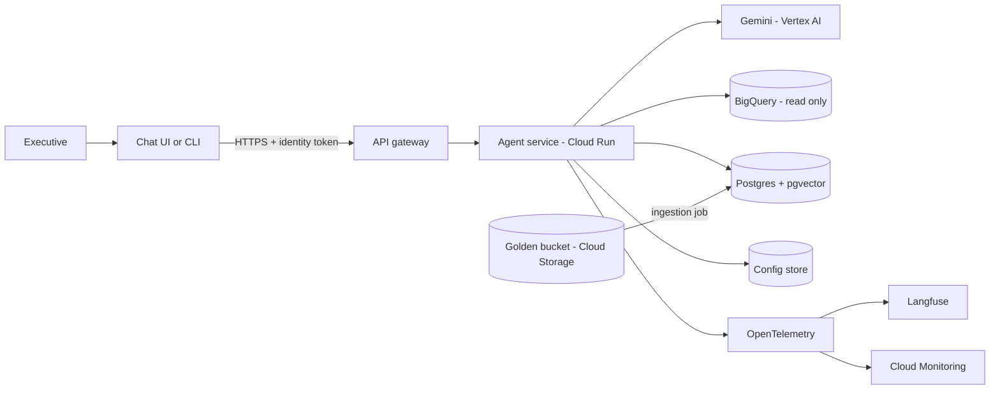

# High-level design

Production design of the retail data-analysis assistant, with the status of each part in the prototype.
Diagram source: [architecture.mmd](architecture.mmd).
Decisions the brief leaves open: [assumptions.md](assumptions.md).

## 1. What we are building

Non-technical executives ask questions about sales and performance in plain language and discuss the answers.
The agent writes SQL on BigQuery, reads the results, explains them and, on request, produces a report with action items.
Four properties shape the whole design:

- It answers only analysis questions, and an executive sees only the products assigned to them.
- Personal data of shoppers never reaches the output.
- Deleting a saved report is the only destructive action, and it always needs an explicit confirmation.
- A failure of Gemini or BigQuery degrades the answer, never the interface.

## 2. Architecture

The detailed diagram, with the internals of the agent service and the learning loop, is in [architecture.mmd](architecture.mmd).

### Components and why

| Block | Choice | Why |
| ----- | ------ | --- |
| Front end | Web chat in production, CLI in the prototype | The agent core is a library with no UI code, so a new front end is a thin adapter. |
| API gateway | Managed gateway with OIDC identity tokens | The user id comes from a verified token and is never taken from the model or the request body. |
| Agent service | Python on Cloud Run, stateless | Scales to zero, scales out per request, and keeps conversation state in Postgres so any instance can serve any turn. |
| LLM | Gemini through Vertex AI in production, AI Studio key in the prototype | The brief asks for Gemini. Vertex AI adds IAM, quotas per project and regional control. A second, cheaper model is the fallback. |
| Agent framework | Plain Python loop on the `google-genai` SDK | The flow is a bounded pipeline with a few tools. A framework would add indirection without adding a capability we need. LangGraph becomes worth it if workflows need to survive restarts or involve long human approvals. |
| Warehouse | BigQuery, read-only service account | The data already lives there. The account can run queries and cannot write. |
| State | Cloud SQL Postgres with the `pgvector` extension | Saved reports, pending deletions, preferences and the knowledge index in one engine. |
| Golden bucket | Cloud Storage, versioned | The source of truth for the analysts' trios. Files are reviewable and recoverable. |
| Config store | Versioned documents in a bucket or database | Persona text, metric definitions and user scopes change without a deploy. |
| Secrets | Secret Manager | Keys never live in images or repositories. |
| Observability | OpenTelemetry to Langfuse and Cloud Monitoring | See section 5.7. |

## 3. Request flow

1. The gateway verifies the identity token and passes a trusted user id to the agent service.
2. Input safety decides whether the message is an analysis request. Off-topic requests, requests for personal data and instruction-override attempts get a polite refusal and no model call is spent on them.
3. The orchestrator loads the user's product scope, the persona text and the metric definitions.
4. Knowledge retrieval finds the most similar approved trios for the question.
5. The first Gemini call receives the question, the conversation, the schema description, the metric definitions and the retrieved trios, and writes the SQL.
6. Guardrails check the SQL deterministically: a single `SELECT`, allowed tables only, no personal columns, and a rewrite so only the user's products are visible.
7. The warehouse client runs a dry run to estimate cost, refuses an over-budget query, executes it with retries on transient errors, and returns rows.
8. Rows pass through result masking as a second line of defense.
9. A bad query or an empty result goes back to the model together with the error for a bounded number of corrections.
10. The second Gemini call receives the aggregated results and writes the answer or report, separating observed facts from hypotheses.
11. The answer returns to the user. If the user asks to save the report, the report tools store it in Postgres.
12. Every step emits a trace event tagged with one trace id per turn.

## 4. Data and where it lives

| Data | Store | Notes |
| ---- | ----- | ----- |
| Raw transactions | BigQuery | Never copied. The agent only reads aggregates. |
| Saved reports, pending deletions | Postgres | Owned by one user. Deletion is soft and recoverable for 30 days. |
| Conversations | Postgres | Needed for "delete the reports from this conversation" and for follow-up questions. |
| User preferences | Postgres | Section 5.4. |
| Golden trios | Cloud Storage and Postgres | Files are the source of truth. Embeddings and metadata sit in Postgres for search. |
| Persona, metrics, scopes | Config store | Versioned, so a bad change can be rolled back. |
| Traces and logs | Langfuse and Cloud Monitoring | Prompts and results are stored with the same masking rules as the output. |

## 5. How each requirement is handled

Status column: **built** means the module exists with tests in the prototype, **planned** means it is part of the prototype but not built yet, **design** means production design only.

### 5.1 Hybrid intelligence (Golden Knowledge) - planned in prototype, design in full

A trio is a question, the SQL queries an analyst used and the analyst's report.
The agent uses trios to learn which metrics to look at, how to break a problem down and how to word conclusions, and it always writes fresh SQL for the new question.

- **At question time:** the question is embedded and the top three approved trios are retrieved from `pgvector`. They are placed in the prompt as guidance, with the instruction not to copy them.
- **Filtering:** trios are filtered by the user's permissions before they reach the prompt, because a report about a product the user cannot see would leak it.
- **Prototype:** five invented trios and a word-overlap ranking. Only the retrieval method differs from production.
- **Adding:** a new trio goes through validation (its SQL parses and runs, its numbers match its report, no personal data), then analyst approval, then it is written to the bucket, embedded and indexed.
- **Updating:** a changed trio becomes a new version and is re-indexed. The old version is kept for audit.
- **Retiring:** a trio is marked inactive and excluded from retrieval, for example when a metric definition changes. Age alone is not a reason, because old methods can stay valid.
- **Deleting:** content, embeddings and cached copies are removed when required, for example for a legal reason.
- **Why an approval step:** a successful query does not prove the analysis is right. Unverified model output must not become trusted knowledge.

### 5.2 Safety and PII masking - built (guardrails)

Security is enforced by code around the model, never by the prompt.

- **Input safety:** only analysis questions are answered. Other requests, attempts to reveal instructions and attempts to widen access are refused.
- **SQL guardrails (built):** one `SELECT` on the four tables only. Personal columns (names, emails, street address, postal code, coordinates) are refused wherever they appear. City, state and country are allowed only as grouping dimensions of aggregates.
- **Product scoping (built):** after the model writes the SQL, `products` and `order_items` are replaced by filtered subqueries that contain only the user's categories. The model cannot widen this, whatever it writes.
- **Known limit:** `orders` and `users` are not product-scoped, so an order count across all products could be inferred. In production the scoping moves into BigQuery as authorized views with row-level access policies per executive group.
- **Result masking (built):** values that look like emails or phone numbers are redacted from returned rows, as a second line of defense.
- **Identity:** the user id comes from the verified token and is passed to every tool by the service, never by the model.
- **Defence in depth in production:** the read-only service account, per-group authorized views and the prompt rules each stop a different failure.

### 5.3 High-stakes oversight (destructive operations) - built (reports)

The database is read-only, but the saved reports library can be changed, so deletion is the one destructive action.

- **No direct path:** the model has no way to delete. It can call a "request delete" tool, which only lists what would be removed.
- **Confirmation:** the user sees the list ("these 4 reports mention Client X") and must confirm. The confirmation deletes exactly the set that was listed, so reports created in between are untouched.
- **Safeguards:** a pending deletion is single-use, expires after 10 minutes and works only for the user who requested it.
- **Ownership:** a user can only match, delete or restore their own reports.
- **Soft delete:** deleted reports stay recoverable for 30 days and are purged after that.
- **UX:** one short prompt listing the reports, answered with a single word. The same flow serves "delete all reports mentioning Client X" and "delete all reports from this conversation".

### 5.4 Continuous improvement - design

**User level.**
The system keeps a small preference profile per user in Postgres: format (table or bullet points), depth, chart or text, language and tone.
Preferences come from two sources: explicit statements ("always use tables") are stored at once, and repeated behavior (always asking for more detail, always editing a report the same way) is stored as a suggestion after enough occurrences.
At each turn the profile is added to the prompt in a few lines. The user can see, edit and reset it.

**System level.**
Traces and feedback feed an offline loop:

1. Turns are scored: explicit thumbs, follow-up corrections ("that is wrong"), retries needed, and automated checks.
2. Failures are clustered by cause (wrong metric, wrong join, refused by guardrail, empty result).
3. Good, verified analyses become candidate trios. Failures become new test cases in the evaluation set.
4. Candidates pass automatic checks and analyst approval before entering the Golden bucket.
5. Prompt and metric changes are tested against the evaluation set before they are released.

The model weights are never changed. Improvement comes from better trios, better definitions, better prompts and a growing evaluation set.

### 5.5 Resilience and graceful error handling - built (llm, warehouse), loop planned

| Failure | Handling |
| ------- | -------- |
| Gemini returns 503 or 429 | Retry with exponential backoff and jitter, then switch to the fallback model. |
| Gemini model removed (404) | Move to the next model at once. |
| Gemini auth problem | Stop at once with a clear message, no retries. |
| All models down | A friendly message with what the user can still do (open saved reports), no crash. |
| SQL syntax or unknown column | Return the BigQuery message to the model for a correction, at most two corrections. |
| Empty result | The model is told once and may broaden the query (wider period, fewer filters), then it answers that nothing was found. |
| Query too expensive | The dry run refuses it. The model is asked for a narrower query. |
| BigQuery unavailable | Retry with backoff, then a friendly message. |
| Postgres unavailable | Analysis still works. Saving and deleting reports report that they are unavailable. |

Costs are bounded: retries and corrections have hard limits, the byte cap protects BigQuery, and a turn has a ceiling on model calls.
Raw exceptions never reach the user. They are logged with the trace id.
In production a circuit breaker stops calling a failing dependency for a short period, and requests from many users are rate-limited per user.

### 5.6 Quality assurance - design, partly built

**Before deployment.**

- **Unit and integration tests** for every deterministic part (guardrails, warehouse, reports, metrics).
- **Acceptance scenarios**: PII refusal, a product outside the user's scope, deletion with and without confirmation, BigQuery errors, multi-step reports.
- **Golden evaluation set**: questions with expected SQL results. We compare executed results, not SQL text, so different but correct SQL passes.
- **Report checks**: every number in a report must appear in the query results (automatic), and a second model grades the report against the user's intent with a rubric (relevance, correct metrics, observed versus speculative, action items present). Samples are reviewed by a person to calibrate the grader.
- **Safety suite**: a growing list of prompt-injection and data-extraction attempts that must always be refused.
- **Regression gate**: a prompt, model or definition change is released only if the evaluation set does not get worse.

**User experience.**

- Time to first answer and number of turns to a satisfying answer.
- Thumbs and short in-chat feedback.
- Review sessions where executives work on real tasks, and recorded transcripts of confusing moments.
- The rate of "I did not understand" and re-asked questions as a signal of unclear answers.

### 5.7 Observability - planned (local), design (production)

**Metrics at agent level.**

- **Outcomes:** answered, refused, error, needs confirmation, per day and per user group.
- **Failures:** rate by type (guardrail refusal, query failure, empty result, model failure, timeout).
- **Self-correction:** corrections per turn and how often they succeed.
- **Latency and cost:** time per step, tokens per turn and cost per turn.
- **Knowledge:** how often trios are retrieved, and whether answers that used them score better.
- **Quality:** user feedback and automated report-check scores.
- **Safety:** blocked personal-data attempts and blocked product-scope attempts.

**Debugging.**
Every turn has one trace id.
The trace shows the user message, the retrieved trios, each model prompt and reply, each SQL query with its validation result and row count, each retry and the final answer.
Given a bad answer, one search by trace id shows where it went wrong.

**Prototype.**
Structured JSON log lines in a local file, a trace id per turn, a CLI command to show the last trace and a script that summarises failure rate, retries and latency.

**Production.**
The service is instrumented with OpenTelemetry. Traces go to Langfuse for the model-specific views and to Cloud Monitoring for alerts such as error-rate and latency thresholds.

### 5.8 Agility (persona management) - design

The tone of the reports is a text document in the config store, read at the start of every turn.
A non-developer edits it in a small admin page or a shared document connected to the store.
Each save creates a new version with an author and a date, and a bad change is rolled back with one click.
Changes can first be tested on the evaluation set, so a new tone does not break report structure.
The prototype already reads the tone from a file at every turn.

## 6. Extending the system

New capabilities are tools behind one interface: a name, a description, an input schema and a function that receives the trusted user context.
Charts, email delivery and web search would each be one more tool.
The guardrail layer sits around the tools, so a new tool declares what it reads and writes and inherits the confirmation rule if it is destructive or sends something outside.
Sending a report by email, for example, would use the same request-then-confirm flow as deletion.

## 7. Production deployment

- **Compute:** Cloud Run for the agent service, a Cloud Run job for knowledge ingestion.
- **Networking:** private connectivity to Cloud SQL, outbound only to Vertex AI and BigQuery.
- **Environments:** development, staging and production, each with its own project and service accounts.
- **Delivery:** the container is built once and promoted. The evaluation set is the gate between staging and production.
- **Scaling:** stateless instances, so scaling is by request count. BigQuery cost is controlled per query and per user.
- **Cost levers:** a cheaper model for planning and routing, caching of repeated aggregate queries for a short time, and the byte cap.

## 8. Prototype and production

| Part | Prototype | Production |
| ---- | --------- | ---------- |
| Front end | CLI | Web chat behind an API |
| Identity | Simulated executives in a config file | Identity provider token |
| Product scope | Query rewrite in code | Same, plus BigQuery authorized views |
| LLM | Gemini through an AI Studio key | Gemini on Vertex AI |
| Golden retrieval | Word overlap over a few files | `pgvector` over an approved bucket |
| Observability | Local JSON log and trace command | OpenTelemetry to Langfuse and Cloud Monitoring |
| Persona | File read at every turn | Versioned store with an admin page |
| Preferences, learning loop | Design only | Postgres profile and offline loop |
